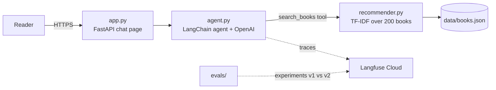

# مساعد القراءة: Reading Assistant

An Arabic chat agent that recommends **real books from a catalog**. It is tested with
**Langfuse** evals and deployed on **AWS ECS Express Mode** with HTTPS.



| Lesson | What we built | Files |
|---|---|---|
| 1. Recommender | TF-IDF search over 200 Arabic book descriptions | `build_books.py`, `recommender.py`, `notebooks/01_data_check.ipynb` |
| 2. Agent | LangChain agent (OpenAI) that calls the recommender as a tool | `agent.py`, `prompts.py` |
| 3. Evals | Langfuse dataset, 2 scorers, prompt v1 vs v2 experiments | `evals/`, [`docs/langfuse-evals.md`](docs/langfuse-evals.md) |
| 4. Deployment | FastAPI web app in a container on ECS Express Mode (HTTPS) | `app.py`, `Dockerfile` |

---

## Lesson 1: The recommender (search, not training)

**Data:** the [Jamalon Arabic Books Dataset](https://www.kaggle.com/datasets/dareenalharthi/jamalon-arabic-books-dataset)
on Kaggle (8,986 rows). We checked it in Google Colab (`notebooks/01_data_check.ipynb`):

- 4,543 rows have no description, and 3,969 of those hold the literal text `"None"`
  (pandas reads that as missing unless you pass `keep_default_na=False`)
- 662 duplicate titles and 8 texts in Arabic presentation forms
- **3,964 usable books.** We take a balanced sample of **200** (about 15 per category,
  13 categories, seed 42)

`build_books.py` cleans the text (NFKC, whitespace, "None" → empty) and drops short
descriptions and duplicates. It writes `data/books.json`.

`recommender.py` normalizes Arabic: it removes tashkeel and unifies alef forms,
ta marbuta → ha, alef maqsura → ya, and Persian look-alikes. It then uses
**TF-IDF on character 3–5-grams**, which copes with Arabic prefixes and suffixes, and
**cosine similarity** to return the top 5 matches.

```bash
pip install -r requirements.txt
python build_books.py --csv "jamalon dataset.csv" --limit 200   # → data/books.json
python recommender.py "رواية تاريخية قصيرة"
```

## Lesson 2: The agent (an LLM in a loop with one tool)

`agent.py` uses LangChain's `create_agent` (built on LangGraph):

1. the LLM (`gpt-5.4-mini-2026-03-17`, a pinned snapshot so evals stay reproducible) reads
   the question
2. it calls the tool `search_books(query)`, which wraps `recommender.py`
3. it reads the 5 results and answers in Arabic

`prompts.py` holds the system prompts. **v1** is deliberately simple. **v2** is the fixed
version from Lesson 3.

```bash
read -s OPENAI_API_KEY && export OPENAI_API_KEY          # typed hidden, never committed
export OPENAI_MODEL=gpt-5.4-mini-2026-03-17
PROMPT_VERSION=v2 python agent.py
```

## Lesson 3: Evals with Langfuse

**Full step-by-step article: [docs/langfuse-evals.md](docs/langfuse-evals.md).**

- `evals/questions.json`: 12 fixed questions, 8 normal and 4 traps (Mahfouz, Harry Potter,
  bedtime stories, Python programming), each with the *expected behaviour*
- `evals/upload_dataset.py`: uploads them as the Langfuse dataset `reading-assistant-evals`
- `evals/evaluators.py`: two scorers
  - `real_books`: an LLM lists the recommended titles, then **code** checks each one exists in
    `books.json`
  - `fits_request`: an **LLM judge** (`gpt-5.4`) scores 1–5 against the expected behaviour
- `evals/run_experiment.py --prompt v1|v2`: runs the dataset through the agent and scores it

```bash
read -s LANGFUSE_PUBLIC_KEY && export LANGFUSE_PUBLIC_KEY
read -s LANGFUSE_SECRET_KEY && export LANGFUSE_SECRET_KEY
export LANGFUSE_BASE_URL=https://cloud.langfuse.com
python evals/upload_dataset.py
python evals/run_experiment.py --prompt v1
python evals/run_experiment.py --prompt v2
```

| Prompt | real_books | fits_request | What changed |
|---|---|---|---|
| v1 | 0.92 | 0.71 | invented Mahfouz novels, padded lists with unrelated books |
| v2 | **1.00** | **0.90** | catalog-only, honest "not in our catalog", no padding |

## Lesson 4: Deploy on AWS (ECS Express Mode + HTTPS)

`app.py` is a small FastAPI server:

| Route | Purpose |
|---|---|
| `GET /` | Arabic RTL chat page |
| `POST /chat` | `{"question": …}` → `{"answer": …, "searches": […]}` |
| `GET /health` | `ok`, used by the load balancer health check |

`Dockerfile` builds a `python:3.12-slim` image with only the app files and `data/books.json`.
**No secrets are baked in.**

Steps we followed, mostly in the AWS console:

1. **Test locally in CloudShell:** `uvicorn app:app --port 8080`, then `curl /health` and `/chat`
2. **Build** the image in CloudShell: `docker build -t reading-assistant:v1 .`
3. **Amazon ECR:** repository `reading-assistant`. Push using the console's
   *View push commands* (login → tag → push)
4. **AWS Secrets Manager:** one secret, `reading-assistant/keys`, with the JSON keys
   `OPENAI_API_KEY`, `LANGFUSE_PUBLIC_KEY` and `LANGFUSE_SECRET_KEY` (values pasted by hand,
   never in code)
5. **ECS → Express Mode → Create:** image URI, container port **8080**, health check
   **/health**, auto-scaling 1–2 tasks, and these environment variables:

   | Name | Type | Value |
   |---|---|---|
   | `OPENAI_MODEL` | plain | `gpt-5.4-mini-2026-03-17` |
   | `LANGFUSE_BASE_URL` | plain | `https://cloud.langfuse.com` |
   | `OPENAI_API_KEY` | secret | `arn:…:secret:reading-assistant/keys-XXXX:OPENAI_API_KEY::` |
   | `LANGFUSE_PUBLIC_KEY` | secret | `…:LANGFUSE_PUBLIC_KEY::` |
   | `LANGFUSE_SECRET_KEY` | secret | `…:LANGFUSE_SECRET_KEY::` |

6. **IAM:** give `ecsTaskExecutionRole` permission to read **only** that secret (inline policy):

   ```json
   {
     "Version": "2012-10-17",
     "Statement": [{
       "Effect": "Allow",
       "Action": "secretsmanager:GetSecretValue",
       "Resource": "arn:aws:secretsmanager:us-east-1:<account-id>:secret:reading-assistant/keys-*"
     }]
   }
   ```

Express Mode then creates the cluster, Fargate service, load balancer, **HTTPS certificate**
and a free `https://<id>.ecs.us-east-1.on.aws` domain.

**Problems we hit, and the fixes:**

| Symptom | Cause | Fix |
|---|---|---|
| AccessDenied on the load balancer and certificate | the brand-new infrastructure role hadn't propagated in IAM yet | **Update service** (no changes) = retry |
| container can't start: secret access denied | the task execution role had no Secrets Manager permission | the inline policy in step 6 |
| `503` for about 2 minutes | the container was healthy but traffic was still switching over | wait |

**To update the app:** build and push a new tag (for example `:v2`), then
**ECS → service → Update service → Image URI**.

**Cost:** about $1.50–2 a day while running (load balancer + Fargate + $0.40/month for the
secret). **To clean up:** ECS → *Delete service*, then delete the ECR images and the secret.

---

## Repo layout

```
app.py              Lesson 4: FastAPI web app
Dockerfile          Lesson 4: container image
agent.py            Lesson 2: LangChain agent + Langfuse tracing
prompts.py          Lesson 2/3: system prompts v1 and v2
recommender.py      Lesson 1: Arabic TF-IDF search
build_books.py      Lesson 1: Jamalon CSV → data/books.json
data/books.json     the 200-book catalog
evals/              Lesson 3: dataset, scorers, experiment runner
docs/               Lesson 3: Langfuse step-by-step article
notebooks/          Colab exploration (data check)
```

## Data attribution

Book titles, authors, categories and descriptions come from the
[Jamalon Arabic Books Dataset](https://www.kaggle.com/datasets/dareenalharthi/jamalon-arabic-books-dataset)
by Dareen Alharthi on Kaggle, collected from the [Jamalon](https://jamalon.com) online bookstore.
This project uses a 200-book sample of catalog metadata for educational purposes.
