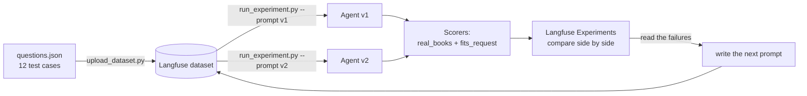
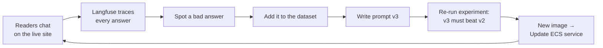

# Testing an AI agent like software: Langfuse, step by step

> How we traced, tested and improved «مساعد القراءة», an Arabic book-recommendation
> agent, with **Langfuse Cloud**. Then we kept tracing it after deploying to AWS.

Without evals, "prompt v2 is better" is just a feeling. This article walks through how we
turned it into a number we could check: **v1 → v2 took `fits_request` from 0.71 to 0.90 and
`real_books` from 0.92 to 1.00**, on the same 12 questions.



---

## Step 1: Create the account and keys

1. Sign up at **https://cloud.langfuse.com** (EU region, free Hobby plan).
2. A default organization and project ("My Project") are created for you.
3. **Settings → API Keys → Create new API keys** gives a *public key* (`pk-lf-…`) and a
   *secret key* (`sk-lf-…`).

The keys never go in code or Git. In CloudShell we typed them into hidden prompts:

```bash
read -s LANGFUSE_PUBLIC_KEY && export LANGFUSE_PUBLIC_KEY
read -s LANGFUSE_SECRET_KEY && export LANGFUSE_SECRET_KEY
export LANGFUSE_BASE_URL=https://cloud.langfuse.com
python -c "from langfuse import get_client; print(get_client().auth_check())"   # True
```

In production (Lesson 4) the same keys come from **AWS Secrets Manager** (see the README).

---

## Step 2: Tracing, seeing inside every answer

The agent is a LangChain `create_agent` loop. Langfuse plugs into it with one callback
(`agent.py`):

```python
def langfuse_callbacks() -> list:
    if not os.environ.get("LANGFUSE_PUBLIC_KEY"):
        return []                      # tracing is optional
    from langfuse.langchain import CallbackHandler
    return [CallbackHandler()]
```

Every question then becomes a **trace** in **Tracing**:

```
LangGraph                 1.86 s   $0.002   ← the whole run
├── model → ChatOpenAI    0.64 s            ← LLM decides to call the tool
├── tools → search_books  0.01 s            ← our TF-IDF recommender (no LLM, ~free)
└── model → ChatOpenAI    0.91 s            ← LLM reads 5 books, writes the answer
```

What to look at:

- **Tree view:** click any step to see its exact input and output. For example the tool
  call `search_books(query="المدارس الحديثة")`, the 5 books it returned, and the final answer.
- **Timeline view:** the same steps as bars over time. The recommender takes **7 ms** and
  the LLM calls take nearly all the time and money. To make the agent faster or cheaper,
  work on the LLM steps.
- **Debugging rule:** if the right book was in the tool output but missing from the answer,
  it's a **prompt** problem. If the right book never came back from the tool, it's a
  **recommender** problem.

---

## Step 3: The dataset, 12 questions that never change

`evals/questions.json` holds 12 Arabic requests. Each one has an **expected behaviour**,
not an exact answer:

| Type | Count | Example | Expected behaviour |
|---|---|---|---|
| `normal` | 8 | «أريد رواية تاريخية» | recommend matching books **from the catalog** |
| `trap_out_of_catalog` | 2 | «أريد رواية لنجيب محفوظ» | say honestly we don't have it, invent nothing |
| `trap_gap` | 2 | «أريد قصصا قبل النوم لأطفالي» | say honestly the catalog has a gap |

The traps matter most, because they are where an LLM is most tempted to make things up.

```bash
python evals/upload_dataset.py
```

This creates the dataset **`reading-assistant-evals`** (Langfuse → **Datasets**). Each item
has a stable id (`reading-assistant-evals-t01`), so re-running the script updates items
instead of duplicating them. The dataset staying fixed is what makes runs comparable.

---

## Step 4: Scorers, how an answer gets a number

`evals/evaluators.py` defines two scores per answer, both from 0 to 1:

| Score | What it measures | Who decides |
|---|---|---|
| `real_books` | share of recommended titles that really exist in `data/books.json` | an LLM **lists** the titles, then **plain code** checks each one against the catalog |
| `fits_request` | does the answer fit the request *and* the expected behaviour? | an **LLM judge** (`gpt-5.4`, stronger than the agent), scoring 1–5 then mapped to 0–1, with a one-line reason |

Two design choices worth copying:

1. **Code over judgment where possible.** "Is this exact title in our 200 books?" is a fact,
   so code decides it, not an LLM that can be fooled.
2. **The judge sees what the tool returned.** It gets the list of books the search actually
   found, so it can tell "recommended a book from the results" apart from "made up a
   famous book".

A third, run-level evaluator (`averages`) writes `avg_real_books` and `avg_fits_request`
for the whole run.

---

## Step 5: Run the experiment for prompt v1, the baseline

```bash
python evals/run_experiment.py --prompt v1
```

`run_experiment.py` calls Langfuse's `dataset.run_experiment(...)`, which:
1. sends each of the 12 questions through the agent (4 in parallel), traced,
2. runs `real_books` and `fits_request` on each answer,
3. runs `averages` on the whole run,
4. links everything in **Experiments**.

**v1 baseline:** `real_books` **0.92**, `fits_request` **0.71**.

Reading the low scores in **Scores** (each one links to its trace) showed four failure
patterns:

| # | Failure | Example |
|---|---|---|
| 1 | recommends famous books **from memory** | t01: three Mahfouz novels, none in the catalog (0 / 0) |
| 2 | **pads the list** with books that don't fit | q05: *Robinson Crusoe* presented as a memoir. t03: parenting guides presented as bedtime stories |
| 3 | **offers things it never saw** in the results | q06 |
| 4 | picks **weak matches over strong ones** | q01, q03 |

Prompt v1 never forbade any of this. That was deliberate, so we'd have something to measure.

---

## Step 6: Write prompt v2 from the failures

Each rule in `prompts.py` → `PROMPT_V2` targets one failure pattern:

1. always search first, and search again with other words if the results are weak
2. recommend **only** books that appeared in the tool results, never from memory (fixes #1)
3. only books that really match, strongest first, no padding (fixes #2 and #4)
4. if nothing fits, say «لا يوجد في كتالوجنا حاليًا كتاب يناسب طلبك» (fixes the traps)
5. never promise books or topics not in the results (fixes #3)
6. title, author and a short reason for each book

---

## Step 7: Run v2 and compare side by side

```bash
python evals/run_experiment.py --prompt v2
```

Then go to **Langfuse → Experiments**, pick **prompt-v1** as the baseline and add
**prompt-v2** under **Compare**:

| | v1 | v2 |
|---|---|---|
| real_books | 0.92 | **1.00** |
| fits_request | 0.71 | **0.90** (+0.19) |
| latency | 2.34 s | 2.50 s |
| cost (12 questions) | $0.024 | $0.030 |

Per question, `fits_request` went **up on 4 and down on 3**:

- ↗ Mahfouz 0 → 1 · bedtime stories 0 → 1 · memoirs 0.25 → 1 · historical novel 0.75 → 1
- ↘ management, journalism, nature science 1 → 0.75 (the stricter prompt gives fewer,
  more careful picks)

The trade-off is honest and visible. v2 is a little slower and costlier because it sometimes
searches twice, and in exchange it **never invents a book**. Without the comparison, the
3 small regressions would have gone unnoticed.

---

## Step 8: Keep tracing in production

The deployed app (`app.py` on ECS Express Mode) calls the same `agent.ask(...)` with the same
callback. The Langfuse keys arrive as environment variables from AWS Secrets Manager, so
**every real chat appears in Tracing**. For example, a live «أريد رواية لنجيب محفوظ» answered
honestly with v2 behaviour and traced end to end.

That closes the loop:



---

## Where to click in Langfuse

| Page | Use it to… |
|---|---|
| **Tracing** | open any single answer: tree, timeline, inputs, outputs, cost |
| **Datasets → reading-assistant-evals → Items** | see or extend the 12 test cases |
| **Datasets → … → Experiments** | the scoreboard of all runs, with a trend chart |
| **Experiments → Compare** | v1 vs v2 per question, with ↗ / ↘ counts |
| **Scores** | every score with the judge's reason, linked to its trace |
